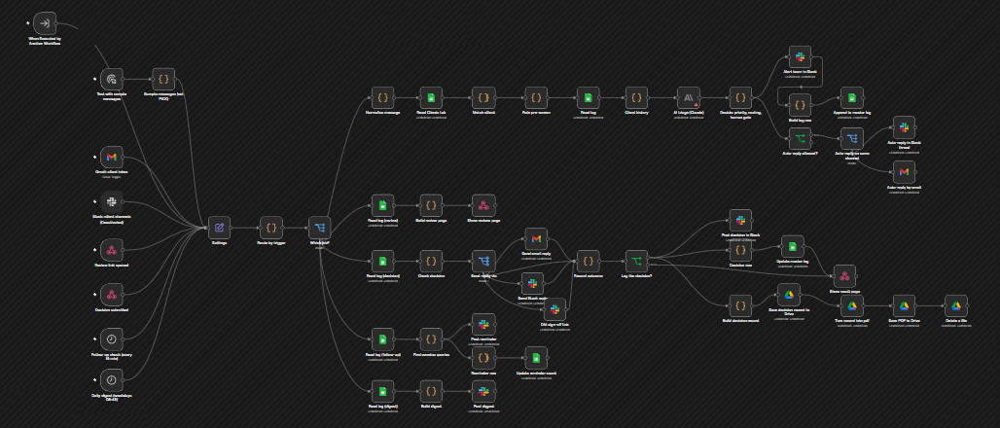

# Client-Query Triage: AI Suggests, Humans Decide

**Type:** Individual project, built as a case study for a RegTech start-up's client-success team (company name removed)
**Tools:** n8n, Anthropic Claude (Haiku 4.5), Slack, Gmail, Google Sheets, Google Drive
**Files:** [`client_query_triage_workflow.json`](client_query_triage_workflow.json) (importable n8n workflow)

## Problem

A client-success team receives questions from many clients across email and Slack. Urgent product issues get buried, replies are inconsistent, and nobody can see later who approved what. **How can AI speed up triage without ever sending something to a client that no one has approved?**

## Design

One workflow, five jobs:

1. **New message** (email, Slack, form or test set) → match the client → rule-based pre-screen → AI triage → policy check → Slack alert + master log
2. **Review page**, opened from the Slack alert
3. **Decision:** a named person approves, edits or declines; the reply is sent and the sign-off logged, with a decision record saved as a PDF
4. **Follow-ups** every 15 minutes, only for queries still open
5. **Daily digest** on weekday mornings

## Built for trust

- **AI suggests, rules decide.** One AI call per message classifies it, translates it and drafts a reply in the client's language. Keyword rules stay as a safety floor, and the higher priority always wins.
- **Every AI draft is policy-checked in code:** no promised deadlines, no admitting fault, no refunds or discounts. A failing draft is replaced by an approved template.
- **Named human sign-off.** Nothing reaches a client until a named person approves it, and *Approved by*, *Approved at* and *Decision* are logged. Decisions are single-use, so a reply can't be sent twice.
- **Security:** client messages are treated as untrusted data, so prompt-injection attempts are flagged and ignored; unknown senders are flagged for verification; review links carry a secret token.
- **Resilience:** if the AI is unavailable, triage still runs on rules and templates.

## Result

In testing, the workflow routed all ~10 sample queries correctly and cut drafting AI-assisted replies to complex queries to under a minute each, with a human approving every reply before it was sent.

## Run it

1. In n8n, choose **Import from file** and select the JSON.
2. Add credentials for Anthropic, Google Sheets, Slack and Gmail.
3. Fill in the **Settings** step: channels, your n8n webhook address, a random token, approvers and booking link. All placeholders are in capitals, e.g. `YOUR-N8N-INSTANCE`.
4. To try it without live inboxes, open **Sample messages**, set `PICK` to `'test'`, `'tricky'`, `'languages'` or `'all'`, and execute.
